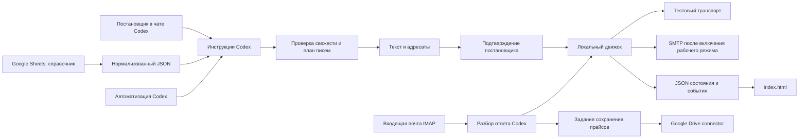

# Архитектура проекта «Закупки»

## Компоненты и поток данных

Диалог, смысловое извлечение брендов и коммерческий разбор выполняет Codex. Детерминированный код отвечает за проверяемые операции: адресатов, состояния, календарь, подтверждение, сроки, дедупликацию, локальные файлы и историю. Отдельный вызов OpenAI API не требуется. Числовую temperature приложения код не меняет; разнообразие формулировок задаётся инструкциями. Локальный составитель текстов нужен для автономных тестов и примеров; рабочие тексты готовит Codex.

## Файлы

| Путь | Назначение |
|---|---|
| AGENTS.md | Маршрутизация естественных запросов в проекте, текущий тестовый режим, ссылка на историю |
| skills/request-price-lists/SKILL.md | Полный сценарий Codex, подтверждение, разбор ответов, ограничения источников |
| config/settings.json | Отправитель, SMTP/IMAP, рабочий календарь, свежесть, переключатели подключений |
| config/catalog-resolutions.json | Подтверждённые правила объединённых ячеек и дополнительных контактов |
| data/source-sheet.json | Снимок исходных значений справочника с происхождением |
| data/catalog.json | Нормализованный рабочий справочник; исходный Google Sheet не меняется |
| data/catalog.test.json | Вымышленные поставщики и адреса для тестов |
| data/test/state.json | Тестовые запросы, письма, цены, задания, уведомления и события |
| data/live/state.json | Рабочая история, создаётся отдельно после начала работы |
| data/{env}/attachments | Вложения; уникальные каталоги позволяют сохранить оригинальные имена |
| data/{env}/outbox | Снимки исходящих MIME-писем |
| data/{env}/imap-cursor.json | UIDVALIDITY и последняя обработанная UID рабочего ящика |
| procurement | Исполняемая логика, стандартная библиотека Python |
| web/history.html | Шаблон самостоятельной истории |
| index.html | Сформированная HTML-история; открывается без сервера и интернета |
| fixtures и tests | Тестовые файлы и сценарии; сетевые действия в тестах запрещены |
| docs | Требования, архитектура, контракт команд и фоновый промпт |

Проект работает через run.ps1 с Python, поставляемым Codex, или Python 3.12+ в PURCHASES_PYTHON. Сторонние Python-пакеты для бизнес-логики не требуются. ZoneInfo использует базу часовых поясов, доступную в комплекте Codex; на другом Windows-окружении может понадобиться tzdata.

## Модель справочника

Brand: каноническое имя и подтверждённые aliases. Supplier: стабильный локальный ID из номера, русское и английское название, язык, признак участия, список контактов/email, список брендов, исходные строки. Контакт не является отдельным поставщиком. Общий диапазон G2:G20 раскрывается для каждого соответствующего поставщика. Алексей сохраняется как источник данных, но enabled=false. Stock исключается из множества брендов.

Перед рабочим планом Codex перечитывает Google Sheet. Снимок нужен для воспроизводимости и локальной работы. Неполная синхронизация не заменяет действующий справочник. Новые или неоднозначные поля требуют уточнения. Папки Диска имеют собственные ID; похожие имена папок и поставщиков не объединяются автоматически. Индекс папок может содержать проверенные маршруты и отдельно неподтверждённые варианты.

## Состояния и подтверждение

Request хранит постановщика, исходную задачу, намерение, отправителя, deliveries, пропуски, блокирующие вопросы и подтверждение. Delivery — одна переписка с одним поставщиком, выбранными адресами и набором пар brand/kind. Пары отмечаются waiting или received независимо друг от друга.

Основные состояния доставки: draft → approved → sending → waiting → completed. Дополнительные: question, exhausted, send_failed, partial_delivery и outcome_unknown. paused — отдельный флаг. Число напоминаний изменяется только после принятого транспортом сообщения. В тестовой среде принятие называется simulated; его нельзя показывать как реальную отправку.

Digest подтверждения охватывает среду, отправителя, адресатов, предмет, темы, тела и правило напоминаний. Служебное изменение статуса полученного прайса не меняет digest. Изменение содержания/адресатов сбрасывает подтверждение. Перед первым письмом ещё раз проверяются свежие прайсы и актуальность инвентаризации.

Перед внешней отправкой состояние sending и стабильный Message-ID сохраняются на диск. При ошибке или падении с неизвестным результатом доставка не повторяется автоматически; требуется сверка. Это предотвращает повторное письмо после неопределённого ответа сервера. Частичное принятие адресов также требует решения пользователя.

## Свежесть и ответы

Price хранит supplier_id, явное coverage по парам бренд/вид, дату/интервал даты, источник, исходное письмо, вложения и ссылки. Срок: stock +7 суток; preorder +1 календарный месяц с ограничением дня последним днём следующего месяца. На границе срока прайс считается устаревшим.

Дата письма берётся из INTERNALDATE IMAP, а не доверенной по умолчанию даты заголовка Date. Датированная папка Диска может задавать день или месяц. Для месяца хранятся date_from/date_to; если все возможные даты свежие — можно пропустить запрос, если все устарели — запросить, иначе уточнить. Неизвестный вид файла не определяется только по категории «стоки и предзаказ».

Inventory checks фиксируют полную проверку пары поставщик/бренд в почте и на Диске. Неуспешная или частичная проверка не равна отсутствию прайса. Для активного запроса уже ожидаемые пары не создаются повторно.

Входящее сохраняется один раз по идентификатору источника. Reply matching использует Message-ID/References/In-Reply-To и отправителя; без заголовков — только однозначный активный запрос. Если поставщик изменил тему, References позволяет сохранить связь. Несколько подходящих запросов или иной отправитель оставляются для ручного сопоставления. Классификация выполняется отдельно от чтения письма.

Полученный PDF или ZIP не считается прайсом только по расширению. Codex проверяет содержимое и записывает evidence/coverage. Ссылка должна быть в исходном письме. Частичный прайс закрывает только свои пары; дальнейшие напоминания касаются остатка. Письмо с вопросом уведомляет постановщика и не закрывает прайс. Неотсортированное письмо временно требует разбора до следующей отправки.

## Календарь и фоновый запуск

Календарь — Europe/Moscow, пн–пт, [09:00, 19:00), ежегодный перерыв 31 декабря–7 января. Один допустимый календарный день означает одинаковое местное время на следующем рабочем дне, а не 24 рабочих часа. Пятница 15:00 → понедельник 15:00. Остальные государственные праздники игнорируются согласно требованию пользователя.

Первое сообщение плюс 5 напоминаний; после последнего ещё один такой же интервал на ответ. Просроченный процесс отправляет максимум одно напоминание за очередную проверку и рассчитывает следующую дату от фактической отправки. После перерыва не отправляется серия накопленных сообщений.

Встроенная автоматизация Codex возвращается в текущий чат и читает долговечные инструкции из проекта. Рекомендуемая проверка — каждые 15 минут в рабочее время. Точная дата напоминания хранится локально, фактический запуск зависит от расписания, доступности компьютера и приложения. Без включённого компьютера локальные файлы недоступны. Это ограничение описано в [официальной документации](https://learn.chatgpt.com/docs/automations).

До окончания тестирования автоматизация находится на паузе. Промпт не включает секретов. Фоновый запуск обрабатывает входящие раньше напоминаний, затем сохраняет подтверждённые файлы и сообщает только новые значимые события. Доставка уведомления и его подтверждение разделены, чтобы не терять сообщение до показа пользователю.

## Адаптеры и секреты

SimulatedTransport записывает локальный результат и не создаёт сетевых соединений. SMTPTransport использует стандартные smtplib/SSL или STARTTLS. IMAP читает только BODY.PEEK и использует readonly-папку. Учётные данные текущего почтового теста берутся из .env (EMAIL_LOGIN/EMAIL_PASSWORD), не из JSON и не из текста чата. Чтение/отправка Mail.ru разрешены для mail_test, но отправка блокируется до успешного mail-check. Запись на Диск выключена.

Каждое сетевое подключение проверяет mode=mail_test или mode=live, общий external_side_effects_enabled и собственный переключатель. В mail_test разрешён только согласованный Gmail; live нельзя запустить при несовпадении среды. Среда test принудительно отключает подключения даже при ошибке конфигурации. На первом этапе нет рабочих мессенджерных адаптеров.

Google Drive выполняет сам Codex через существующий connector. Локальный движок создаёт jobs с именем, источником, покрытием, временем получения и выбранным folder ID. После загрузки Codex проверяет файл чтением metadata и фиксирует URL/ID в complete-job. Для смешанного прайса job остаётся awaiting_route. Тестовое завершение задания принимает только локальный результат simulated.

## Хранение и интерфейс

Состояние одного окружения — единый JSON с коллекциями requests/prices/inventory_checks/inbox/outbox/jobs/notifications/events. Каждая мутация берёт эксклюзивный lock, изменяет копию в памяти и атомарно заменяет файл через os.replace. Предыдущая версия сохраняется как state.json.bak. Остаточный lock после аварии содержит PID; его не удаляют автоматически, пока не проверен владелец. MIME-файлы и вложения хранятся отдельно.

HTML содержит снимок test, mail_test, live и справочника, не требует локального сервера, содержит поиск, фильтр статуса, переписку, файлы и экспорт JSON. Все тексты источников отображаются через textContent, данные в JSON-script экранируются от закрытия тега; URL проверяются по протоколу. UI не отправляет письма и не меняет подтверждение. Снимок обновляется после CLI-операций; для уже открытой страницы нужно обновление просмотра.

## Проверка и переход к рабочему режиму

### Почтовый тест Mail.ru → Gmail

По прямому указанию пользователя добавлена среда mail_test: timur-ildusovich@mail.ru → timurildusovich@gmail.com. Она использует рабочий справочник для группировки и языка, но хранит собственные запросы, ответы и файлы в data/mail_test. Исходные email поставщиков записываются в intended_recipients; фактический recipients содержит ровно один разрешённый Gmail. Ограничение проверяется при подготовке, редактировании, подтверждении, отправке и в SMTPTransport. Получатель и отправитель дополнительно закреплены в procurement/mail_test.py; случайная правка JSON не отменяет согласованные адреса. Маршрут входит в digest и требует нового предпросмотра при изменении.

Учётные данные читаются из .env (EMAIL_LOGIN/EMAIL_PASSWORD), исключённого из Git. Парсер не исполняет команды и не раскрывает переменные; .env имеет приоритет над одноимёнными переменными окружения. Секреты не попадают в состояние, диагностический результат и HTML. mail-check выполняет SMTP login/NOOP и IMAP login/readonly SELECT, без send_message и BODY. Результат без секретов хранится в connection.json. Отправка блокируется до успешного входа. Начальная UIDNEXT задаёт границу новых писем; mail_test poll выбирает только новые сообщения от Gmail и связывает их по References.

Свежесть использует отдельную историю почтового теста. Файлы сохраняются локально с оригинальным именем, без Google Drive jobs. test остаётся без сети даже при включённом mail_test. Автоматизация остаётся на паузе. SMTP Mail.ru: SSL/465, IMAP: SSL/993; требуется пароль внешнего приложения согласно [официальной инструкции Mail.ru](https://help.mail.ru/mail/login/mailer/). Тестовый аккаунт проверен настоящим обменом письмами. Пользователь добавит боевой пароль tam_sabis4@mail.ru в самом конце.

Тесты проверяют бизнес-поведение и отсутствие сетевых вызовов, включая исправление черновика после подтверждения, календарь, частичный ответ, повтор событий и неопределённый SMTP. Демонстрация использует вымышленные контакты, CSV с тестовыми товарами и симуляцию подтверждения; это явно указано в истории.

Разрешение перейти в боевой режим после успешного почтового теста уже получено и сохранено в config/settings.json → production_transition. После настройки пароля и успешного настоящего теста SMTP/IMAP Codex переключает mode=live, отмечает transition.status=completed и сообщает пользователю. Отправитель остаётся tam_sabis4@mail.ru; новый рабочий запрос использует актуальный справочник и все email выбранных по брендам участвующих поставщиков. Каждое новое письмо/рассылка согласуется отдельно; тестовые запросы и подтверждения не мигрируют. Перед записью прайсов на Google Drive проверяются точные маршруты и права. Код тестового симулятора не доказывает работоспособность внешнего аккаунта.

Текущий статус: mode=live, production_transition.status=waiting_for_production_credentials. До успешного `--env live mail-check` для tam_sabis4@mail.ru фактическая рассылка заблокирована. Для него в .env нужны PRODUCTION_EMAIL_LOGIN и PRODUCTION_EMAIL_PASSWORD; тестовую пару EMAIL_LOGIN/EMAIL_PASSWORD сохранять отдельно. Автоматизация на паузе до подключения. Сам переход разрешён; новые рассылки требуют просмотра и подтверждения текстов/адресатов.
